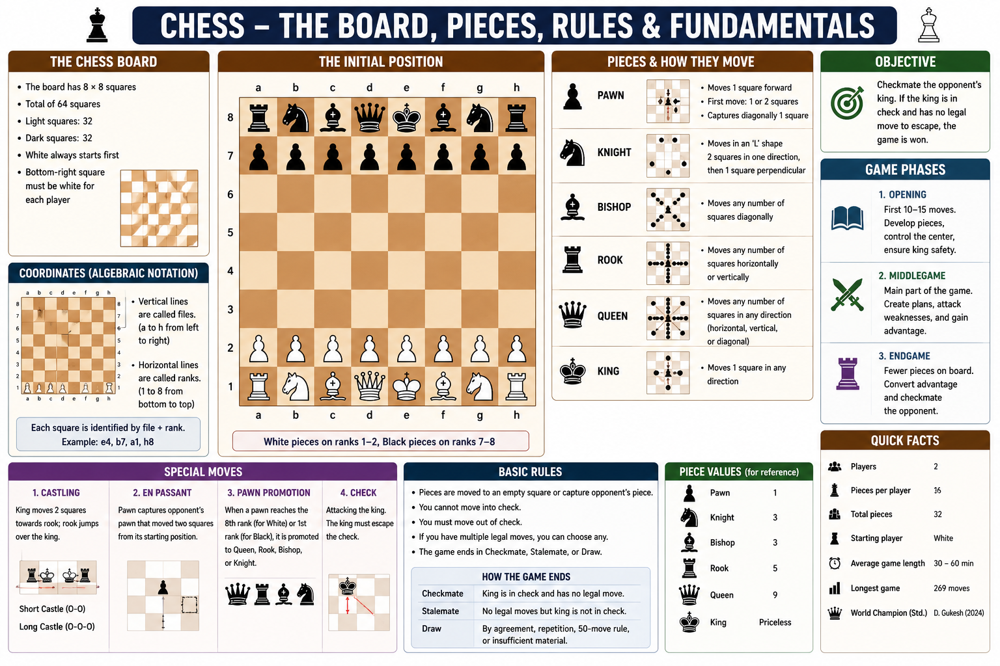

# Chess

Chess is one of the oldest and most popular strategy board games in the world. It is played between **two players**, each controlling **16 pieces** on a board of **64 squares**.

Unlike many other games, chess does not depend on luck. Success comes from planning, strategy, calculation, and decision-making. The objective is to **checkmate** the opponent's king.

---

## Overview

* **Type:** Indoor Strategy Board Game
* **Players:** 2
* **Board:** 8 × 8 (64 Squares)
* **Pieces:** 16 per player
* **Objective:** Checkmate the opponent's king.
* **Governing Body:** FIDE (International Chess Federation)

---

## Topics Covered

* Chess Board
* Chess Pieces
* Rules
* Openings
* Records
* Glossary

---

## Learning Path

```text
Chess
├── Chess Board
├── Chess Pieces
├── Rules
├── Openings
├── Records
└── Glossary
```

---

## Overview


