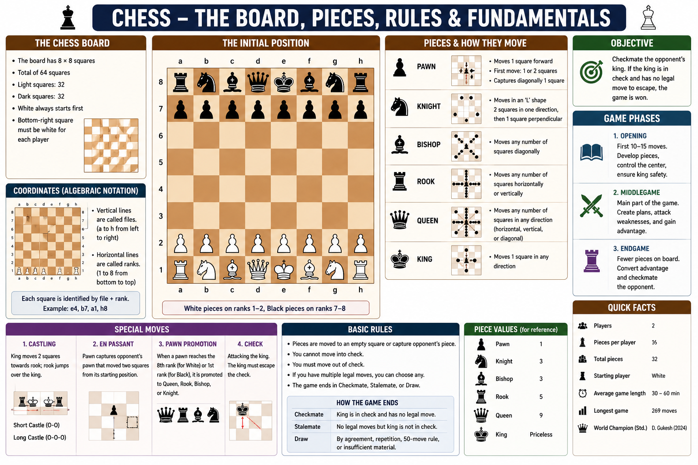

# Chess Board

The chessboard is the playing surface used in a game of chess. It consists of **64 squares** arranged in an **8 × 8** grid with alternating light and dark colors.

Every game begins with the same board setup.



---

## Board Layout

| Feature       | Description          |
| ------------- | -------------------- |
| Rows          | 8 (called Ranks)     |
| Columns       | 8 (called Files)     |
| Total Squares | 64                   |
| Colors        | 32 Light and 32 Dark |

---

## Coordinates

Each square has a unique coordinate.

* Files are labeled **a to h** (left to right).
* Ranks are numbered **1 to 8** (bottom to top).

Example:

```text
8  a8 b8 c8 d8 e8 f8 g8 h8
7  a7 b7 c7 d7 e7 f7 g7 h7
6  a6 b6 c6 d6 e6 f6 g6 h6
5  a5 b5 c5 d5 e5 f5 g5 h5
4  a4 b4 c4 d4 e4 f4 g4 h4
3  a3 b3 c3 d3 e3 f3 g3 h3
2  a2 b2 c2 d2 e2 f2 g2 h2
1  a1 b1 c1 d1 e1 f1 g1 h1

   a  b  c  d  e  f  g  h
```

---

## Initial Setup

* Each player starts with **16 pieces**.
* White pieces are placed on **Ranks 1 and 2**.
* Black pieces are placed on **Ranks 7 and 8**.
* White always makes the first move.

---

## Key Points

* The square in the bottom-right corner from each player's perspective is always **light-colored**.
* The queen starts on her **own color**.
* Every move in chess is identified using the board coordinates.
