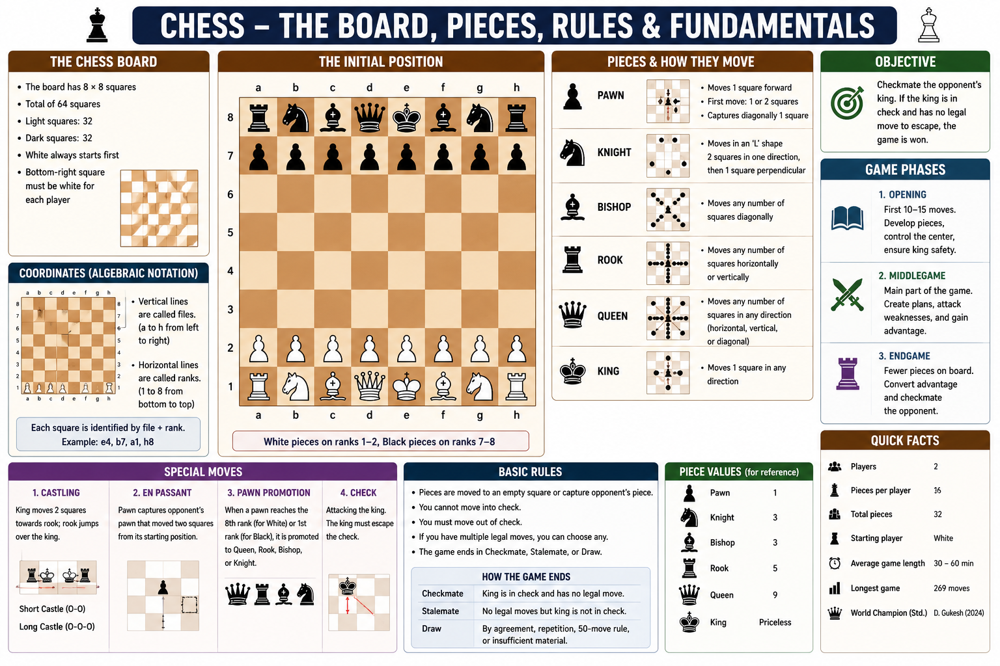

# Pieces

Each player starts the game with **16 pieces**:

* 1 King
* 1 Queen
* 2 Rooks
* 2 Bishops
* 2 Knights
* 8 Pawns

---

## Chess Pieces

| Piece  | Symbol | Quantity | How It Moves                                                                                             |
| ------ | :----: | :------: | -------------------------------------------------------------------------------------------------------- |
| King   |    ♔   |     1    | One square in any direction.                                                                             |
| Queen  |    ♕   |     1    | Any number of squares horizontally, vertically, or diagonally.                                           |
| Rook   |    ♖   |     2    | Any number of squares horizontally or vertically.                                                        |
| Bishop |    ♗   |     2    | Any number of squares diagonally.                                                                        |
| Knight |    ♘   |     2    | Moves in an **L-shape** (2 squares in one direction, then 1 square perpendicular). Can jump over pieces. |
| Pawn   |    ♙   |     8    | Moves forward one square (or two squares on its first move). Captures one square diagonally forward.     |

---

## Piece Value

| Piece  |                                           Value |
| ------ | ----------------------------------------------: |
| Queen  |                                               9 |
| Rook   |                                               5 |
| Bishop |                                               3 |
| Knight |                                               3 |
| Pawn   |                                               1 |
| King   | Cannot be assigned a value (must be protected). |

> Piece values are used as a general guide and may vary depending on the position.

---

## Key Points

* The **King** is the most important piece.
* The **Queen** is the most powerful piece.
* The **Knight** is the only piece that can jump over other pieces.
* A **Pawn** can be promoted when it reaches the last rank.
* The game ends when a king is **checkmated**.
