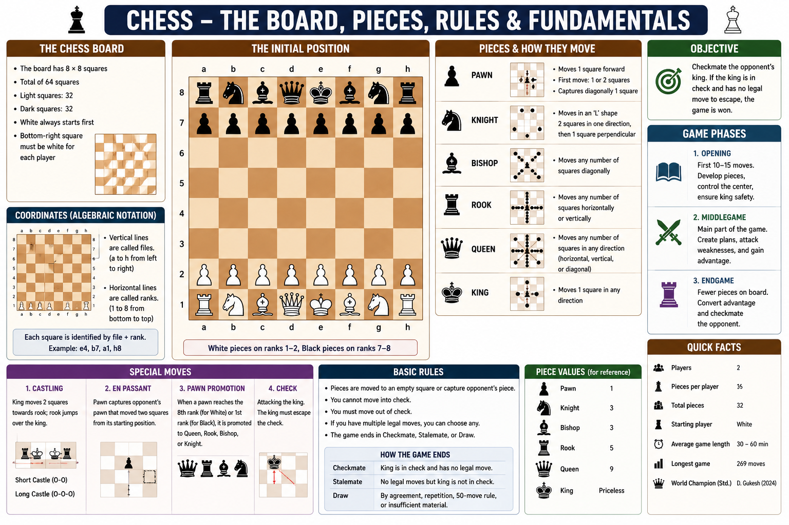

# Rules

Chess is played between **two players**, each starting with **16 pieces** on an **8 × 8 board**. The objective is to **checkmate** the opponent's king.

---

## Starting the Game

* White always moves first.
* Players take turns moving one piece at a time.

---

## Capturing Pieces

* A piece captures an opponent's piece by moving onto its square.
* The captured piece is removed from the board.

---

## Check

A king is **in check** when it is under immediate attack by an opponent's piece.

The player must respond by:

* Moving the king.
* Blocking the attack.
* Capturing the attacking piece.

---

## Checkmate

A player wins by **checkmate**.

Checkmate occurs when:

* The king is in check.
* There is no legal move to escape the attack.

---

## Stalemate

A **stalemate** occurs when:

* A player is **not** in check.
* The player has **no legal moves**.

The game ends in a **draw**.

---

## Castling

Castling is a special move involving the **king** and a **rook**.

Conditions:

* Neither piece has moved before.
* No pieces are between them.
* The king is not in check.
* The king does not move through or into check.

---

## En Passant

En passant is a special pawn capture.

* It can occur only immediately after an opponent's pawn moves two squares forward from its starting position.
* The opposing pawn captures it as if it had moved only one square.

---

## Pawn Promotion

When a pawn reaches the last rank, it must be promoted to one of the following:

* Queen
* Rook
* Bishop
* Knight

Promotion to a **Queen** is the most common choice.

---

## Draw Conditions

A game is drawn if:

* Stalemate
* Insufficient material
* Threefold repetition
* Fifty-move rule
* Mutual agreement between both players

---

## Winning the Game

A player wins by:

* Checkmate
* Opponent resigns
* Opponent loses on time (in timed games)
