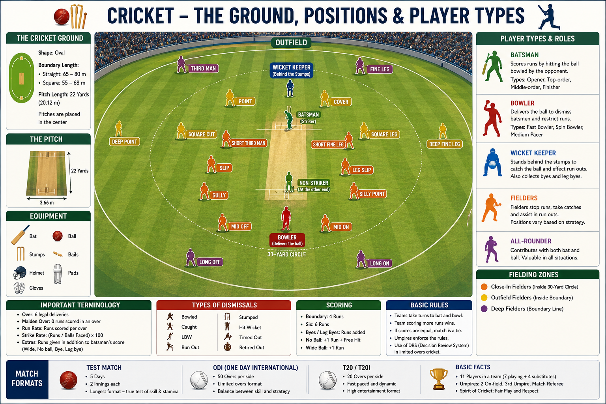

# Cricket Ground

A cricket ground is the playing area where a cricket match takes place. It consists of a large oval or circular field with a **22-yard (20.12 m) pitch** at the center, where the batsmen and bowlers play.

---

## Main Parts of a Cricket Ground

| Part         | Purpose                                                 |
| ------------ | ------------------------------------------------------- |
| Pitch        | The 22-yard strip where batting and bowling take place. |
| Wicket       | Three stumps and two bails at each end of the pitch.    |
| Crease       | Marks used for batting, bowling, and run-outs.          |
| Boundary     | The outer edge of the playing field.                    |
| Infield      | Area inside the 30-yard circle.                         |
| Outfield     | Area between the infield and the boundary.              |
| Sight Screen | Helps the batter see the ball clearly.                  |

---

## Standard Dimensions

| Item              | Measurement                        |
| ----------------- | ---------------------------------- |
| Pitch Length      | 22 yards (20.12 m)                 |
| Pitch Width       | 10 ft (3.05 m)                     |
| Wicket Height     | 28 in (71.1 cm)                    |
| Wicket Width      | 9 in (22.86 cm)                    |
| Boundary Distance | Usually 65–85 m (varies by ground) |

---

## Key Points

* The match is played on a **22-yard pitch**.
* There are **two wickets**, one at each end of the pitch.
* A batter scores runs by running between the wickets or by hitting the ball to the boundary.
* A **Four** is scored when the ball reaches the boundary after touching the ground.
* A **Six** is scored when the ball crosses the boundary without touching the ground.
* The boundary size may vary from one stadium to another.
