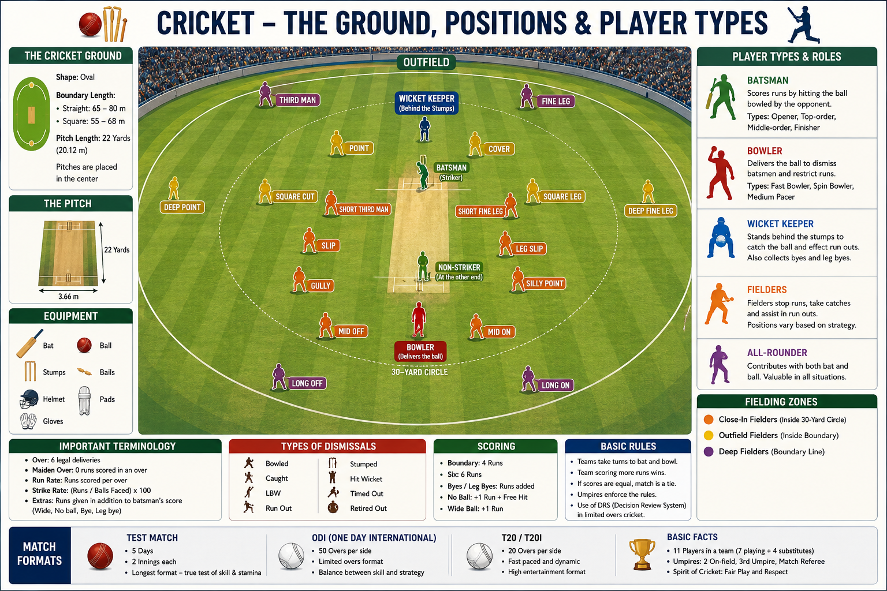

# Fielding Positions

Fielders are placed in different positions around the ground to stop runs, take catches, and dismiss batters. The captain changes these positions depending on the batter, bowler, and match situation.

---

## Close Fielding Positions

| Position    | Location                                   |
| ----------- | ------------------------------------------ |
| Slip        | Beside the wicketkeeper, behind the batter |
| Gully       | Between slips and point                    |
| Point       | Square on the off side                     |
| Silly Point | Very close to the batter on the off side   |
| Short Leg   | Very close to the batter on the leg side   |

---

## Inner Field Positions

| Position    | Location                                      |
| ----------- | --------------------------------------------- |
| Cover       | In front of point on the off side             |
| Extra Cover | Between cover and mid-off                     |
| Mid-off     | Straight in front of the batter               |
| Mid-on      | Straight behind the bowler                    |
| Midwicket   | On the leg side between square leg and mid-on |
| Square Leg  | Square on the leg side                        |

---

## Boundary Positions

| Position        | Location                            |
| --------------- | ----------------------------------- |
| Third Man       | Behind point near the boundary      |
| Fine Leg        | Behind square leg near the boundary |
| Deep Point      | Deep on the off side                |
| Deep Cover      | Deep cover boundary                 |
| Long-off        | Straight boundary on the off side   |
| Long-on         | Straight boundary on the leg side   |
| Deep Midwicket  | Deep leg-side boundary              |
| Deep Square Leg | Deep square leg boundary            |

---

## Common Field Settings

| Field Setting   | Purpose                                                              |
| --------------- | -------------------------------------------------------------------- |
| Attacking Field | More close fielders to take catches                                  |
| Defensive Field | More boundary fielders to prevent boundaries                         |
| Powerplay Field | Limited fielders allowed outside the circle in limited-overs cricket |

---

## Key Points

* Only **11 players** field at a time, including the wicketkeeper and bowler.
* Field placements change throughout the match.
* The captain decides the field based on the batter and bowler.
* Good fielding can save runs and create wicket-taking opportunities.

