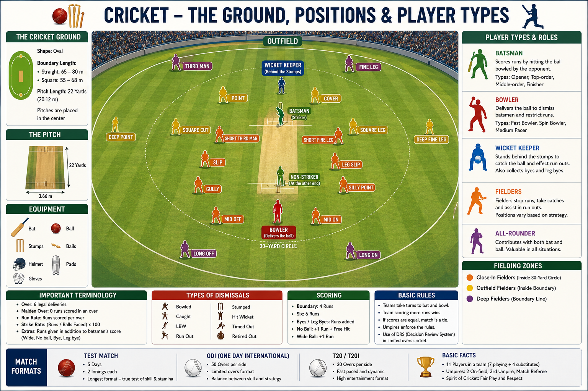

# Player Positions

Each cricket team has **11 players**. Every player has a specific role in batting, bowling, fielding, or keeping wickets. A player may perform more than one role depending on the team's strategy.

---

## Batter

* Scores runs by hitting the ball.
* Tries to stay at the crease without getting out.

---

## Bowler

* Delivers the ball to dismiss the batter.
* Can be a fast, medium-pace, or spin bowler.

---

## All-rounder

* Contributes with both batting and bowling.
* Provides balance to the team.

---

## Wicketkeeper (WK)

* Stands behind the stumps.
* Catches the ball, performs stumpings, and effects run-outs.
* The only fielder allowed to wear gloves.

---

## Captain (C)

* Leads the team on the field.
* Decides batting order, bowling changes, and field placements.

---

## Position Summary

| Position          | Main Role                                 |
| ----------------- | ----------------------------------------- |
| Batter            | Score runs                                |
| Bowler            | Take wickets and restrict runs            |
| All-rounder       | Contribute with both bat and ball         |
| Wicketkeeper (WK) | Keep wickets and assist in dismissals     |
| Captain (C)       | Lead the team and make tactical decisions |

---

## Team Combination

A balanced playing XI usually includes:

* 5–6 Batters
* 1 Wicketkeeper
* 1–3 All-rounders
* 3–5 Bowlers

The exact combination depends on the match format and playing conditions.
