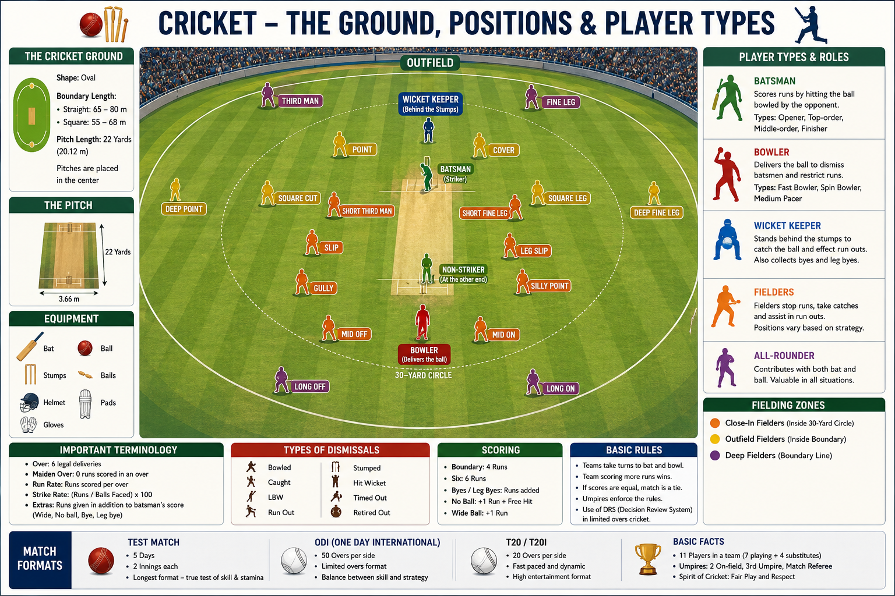

# Rules

Cricket is played between **two teams of 11 players**. One team bats to score runs, while the other bowls and fields to take wickets and limit the runs scored.

The team with the higher score at the end of the match wins.

---

## Toss

* Before the match, the captains toss a coin.
* The winning captain chooses to **bat** or **bowl** first.

---

## Innings

* Each team gets a chance to bat and bowl.
* The number of innings depends on the match format.

| Format | Innings per Team |
| ------ | ---------------: |
| Test   |                2 |
| ODI    |                1 |
| T20    |                1 |

---

## Overs

An **over** consists of **6 legal deliveries** bowled by one bowler.

| Format | Overs per Team |
| ------ | -------------: |
| Test   |      Unlimited |
| ODI    |             50 |
| T20    |             20 |

---

## Scoring Runs

Runs can be scored by:

* Running between the wickets.
* Hitting the boundary (**Four**).
* Hitting the ball over the boundary without bouncing (**Six**).
* Extras awarded by the bowling team.

---

## Ways a Batter Can Be Out

* Bowled
* Caught
* LBW (Leg Before Wicket)
* Run Out
* Stumped
* Hit Wicket
* Run Out
* Obstructing the Field
* Timed Out

---

## Extras

Extra runs may be awarded for:

* Wide
* No Ball
* Bye
* Leg Bye

---

## Powerplay

In ODI and T20 cricket, fielding restrictions apply during specific overs to encourage attacking play.

---

## Result

* **Win** – One team scores more runs than the other.
* **Tie** – Both teams score the same runs with all innings completed.
* **Draw** – Possible only in Test cricket when the match ends without a result.
* **No Result** – Match cannot be completed, usually due to weather.

---

## Match Officials

* Two On-field Umpires
* Third Umpire
* Match Referee

---

## Decision Review System (DRS)

Players can challenge certain umpire decisions using video technology. The third umpire reviews the available evidence before making the final decision.
