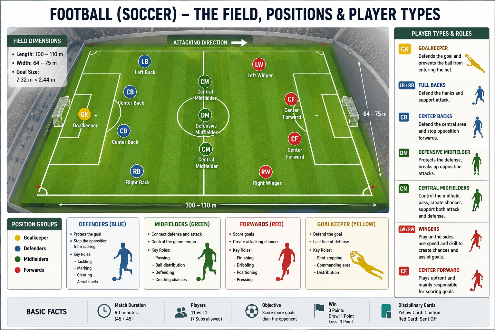

# Football Field

A football field, also known as a **football pitch**, is the rectangular playing area where a football match is played. It is marked with lines and different areas that define the rules of the game.

---

## Main Parts of a Football Field

| Part          | Purpose                                                       |
| ------------- | ------------------------------------------------------------- |
| Goal          | Where goals are scored.                                       |
| Goal Area     | Used for goal kicks.                                          |
| Penalty Area  | Area where fouls can result in a penalty kick.                |
| Penalty Spot  | Spot from where penalty kicks are taken.                      |
| Penalty Arc   | Ensures players stay 9.15 m (10 yards) away during penalties. |
| Corner Arc    | Area where corner kicks are taken.                            |
| Touchline     | Side boundary of the field.                                   |
| Goal Line     | End boundary where the goal is located.                       |
| Halfway Line  | Divides the field into two halves.                            |
| Centre Circle | Used during kick-off.                                         |
| Centre Spot   | Starting point of the match and after every goal.             |

---

## Standard Dimensions

| Item                 | Measurement             |
| -------------------- | ----------------------- |
| Length               | 100–110 m               |
| Width                | 64–75 m                 |
| Goal Width           | 7.32 m                  |
| Goal Height          | 2.44 m                  |
| Penalty Spot         | 11 m from the goal line |
| Centre Circle Radius | 9.15 m                  |

---

## Key Points

* The match starts from the **centre spot**.
* Each team defends one goal and attacks the other.
* Only the goalkeeper can handle the ball inside their own penalty area.
* A goal is scored when the entire ball crosses the goal line between the goalposts and below the crossbar.
