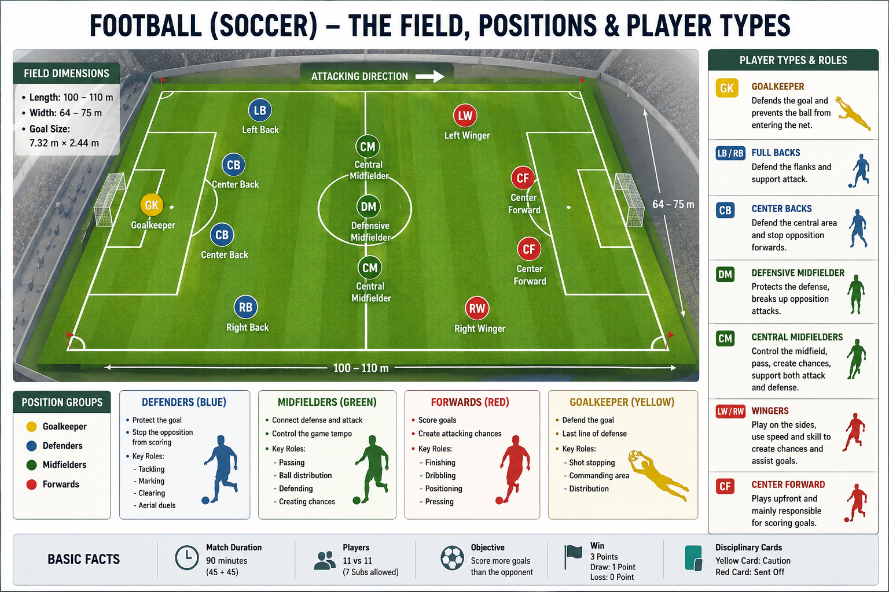

# Player Positions

Each football team has **11 players**, including **1 goalkeeper** and **10 outfield players**. Every position has a specific role in defending, creating chances, and scoring goals.



---

## Goalkeeper (GK)

* Defends the goal.
* Can use hands only inside the penalty area.
* Organizes the team's defense.

---

## Defenders

### Centre Back (CB)

* Stops opposition attackers.
* Wins tackles and headers.
* Clears the ball from dangerous areas.

### Left Back (LB) / Right Back (RB)

* Defends the wings.
* Supports attacks by moving forward.
* Delivers crosses into the penalty area.

---

## Midfielders

### Defensive Midfielder (CDM)

* Protects the defense.
* Wins possession.
* Starts attacking moves.

### Central Midfielder (CM)

* Links defense and attack.
* Controls the tempo of the game.
* Passes and creates chances.

### Attacking Midfielder (CAM)

* Creates goal-scoring opportunities.
* Supports the forwards.
* Often provides assists.

---

## Forwards

### Left Winger (LW) / Right Winger (RW)

* Attacks from the sides.
* Dribbles past defenders.
* Delivers crosses and scores goals.

### Striker (ST)

* Main goal scorer.
* Stays close to the opponent's goal.
* Finishes scoring opportunities.

---

## Common Formation

The most widely used formation is **4-3-3**.

```text
         ST
LW               RW

   CM      CM
       CDM

LB   CB   CB   RB

        GK
```

---

## Position Summary

| Position | Full Form            | Main Role             |
| -------- | -------------------- | --------------------- |
| GK       | Goalkeeper           | Protect the goal      |
| CB       | Centre Back          | Central defender      |
| LB       | Left Back            | Left-side defender    |
| RB       | Right Back           | Right-side defender   |
| CDM      | Defensive Midfielder | Protect the defense   |
| CM       | Central Midfielder   | Control the midfield  |
| CAM      | Attacking Midfielder | Create attacks        |
| LW       | Left Winger          | Attack from the left  |
| RW       | Right Winger         | Attack from the right |
| ST       | Striker              | Score goals           |
