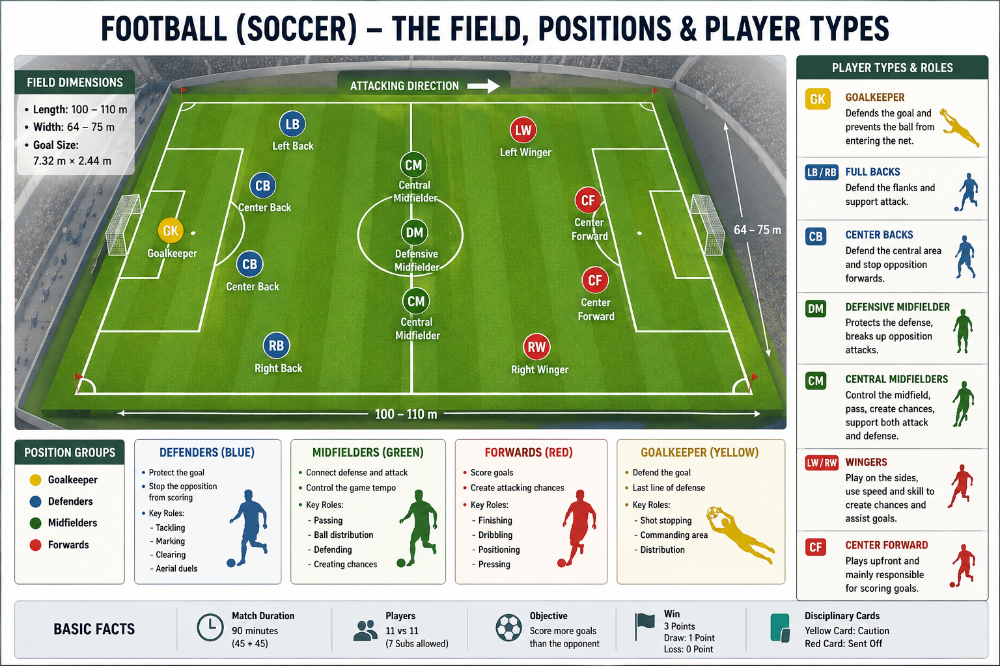

# Rules

Football is played between two teams of **11 players** each. The team that scores the most goals at the end of the match wins.

---

## Match Duration

* 90 minutes
* Two halves of 45 minutes each
* 15-minute halftime break
* Added time may be played at the end of each half.
* Extra time and penalty shootout may be used in knockout matches.

---

## Kick-off

* The match starts with a kick-off from the centre spot.
* A kick-off is also taken after every goal.

---

## Scoring

* A goal is scored when the entire ball crosses the goal line between the goalposts and under the crossbar.

---

## Offside Rule

A player is offside if they are:

* In the opponent's half.
* Closer to the opponent's goal than both the ball and the second-last defender.
* Actively involved in play.

---

## Fouls

Common fouls include:

* Kicking an opponent
* Tripping
* Pushing
* Holding
* Handball (except the goalkeeper inside their own penalty area)
* Dangerous tackles

---

## Cards

| Card        | Meaning                                           |
| ----------- | ------------------------------------------------- |
| Yellow Card | Warning for unsporting behavior or repeated fouls |
| Red Card    | Player is sent off and cannot continue the match  |

---

## Free Kicks

* **Direct Free Kick:** A goal can be scored directly.
* **Indirect Free Kick:** The ball must touch another player before a goal can be scored.

---

## Penalty Kick

A penalty kick is awarded when a defending player commits a foul inside their own penalty area.

---

## Corner Kick

Awarded when the defending team last touches the ball before it crosses the goal line (without a goal being scored).

---

## Goal Kick

Awarded when the attacking team last touches the ball before it crosses the goal line.

---

## Throw-in

Awarded when the ball completely crosses the touchline.

---

## Match Officials

* Referee
* Two Assistant Referees
* Fourth Official
* VAR (Video Assistant Referee) in major competitions

---

## Winning the Match

* Win = More goals than the opponent
* Draw = Both teams score the same number of goals
* Knockout matches may use extra time and penalty shootouts to decide the winner.
