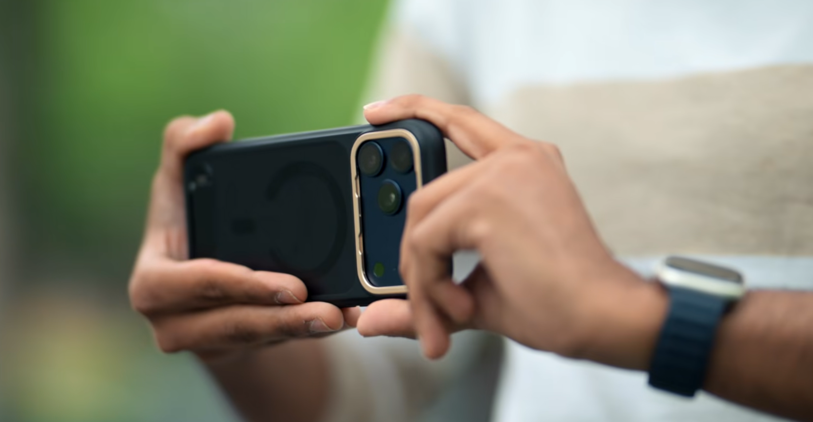

# Videography

## Overview

This document contains practical notes for recording better videos with an iPhone. It focuses on camera settings, shooting techniques, stabilization, and lessons learned from real-world use.

## Video Fundamentals

- Storytelling
- Camera Movement
- Stability
- Lighting
- Audio

## Frame Rate (FPS)

- 24 FPS
- 30 FPS (Recommended for most videos)
- 60 FPS
- Slow Motion
- Use 4K at 30 FPS for most videos.

> Higher FPS needs more light because it uses a faster shutter speed.

## Resolution

- 1080p
- 4K

## Focus & Exposure

- Tap to focus.
- Use AE/AF Lock for static scenes.
- Lock focus before recording moving subjects.
- For focus-pull shots, lock AE/AF on the final subject before recording.

## Lens Selection

- Ultra Wide (0.5×)
- Main (1×)
- Telephoto (2× / 5×)
- On supported iPhone models, 2× recording gives better quality than cropping a 1× video.

For low light, use the main (1×) camera.

## Stabilization

- Keep elbows close to your body.
- Hold the iPhone close to your body.
- Walk slowly and smoothly.
- Switch to a wider lens if shake becomes noticeable.
- When recording from a moving vehicle, support your hand from below for better stability.

## Travel Video Ideas

- Establishing shots
- Walking shots
- Time-lapse
- Slow Motion
- Detail shots
- Wide landscape shots

## Common Mistakes

- Excessive camera movement
- Frequent zooming
- Poor lighting
- Ignoring audio
- Shaky handheld footage

## Field Notes

Write down useful tips, camera settings, and lessons learned.

## References

- iPhone Videography Masterclass: https://www.youtube.com/watch?v=QM2DjRSEKCU